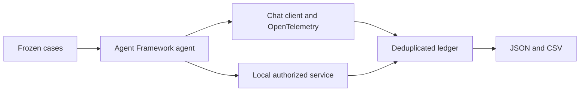

# ContextWindow.AI.AgentCostAccounting

Run two agent settings on the same fictional refund cases. Deduplicate model calls and join attempt costs to business service outcomes. Local synthetic usage and price assumptions are not real model measurements or invoices.



Requires the .NET SDK. Run from the repository root:

```sh
dotnet restore tests/ContextWindow.AI.AgentCostAccounting.Tests/ContextWindow.AI.AgentCostAccounting.Tests.csproj
dotnet build tests/ContextWindow.AI.AgentCostAccounting.Tests/ContextWindow.AI.AgentCostAccounting.Tests.csproj --configuration Release
dotnet test tests/ContextWindow.AI.AgentCostAccounting.Tests/ContextWindow.AI.AgentCostAccounting.Tests.csproj --configuration Release
dotnet run --project src/ContextWindow.AI.AgentCostAccounting/ContextWindow.AI.AgentCostAccounting.csproj --configuration Release
```

The executable prints JSON and escaped CSV and saves `artifacts/report.json` and `artifacts/report.csv`. The observation window is UTC `[start, end)`. Unknown usage produces an incomplete cost, not a zero charge. Cache counts are included in total input. Tool fees are zero for the local service. Other infrastructure and human handling are excluded.

Optional live mode requires `COST_ENDPOINT` (trusted HTTPS chat completions URL), `COST_API_KEY`, `COST_PROVIDER`, `COST_MODEL_A`, `COST_MODEL_B`, `COST_TARIFF_DATE`, `COST_A_INPUT`, `COST_A_CACHED`, `COST_A_OUTPUT`, `COST_B_INPUT`, `COST_B_CACHED`, `COST_B_OUTPUT` and `COST_REPETITIONS` in the process environment. Models must be distinct. Rates are nonnegative USD per million tokens. Repetitions must be 1 to 10. Both models must support the configured endpoint and cached tokens included in input. No secrets are printed. Live mode still uses a fictional local business service, not payments.

```sh
dotnet run --project src/ContextWindow.AI.AgentCostAccounting/ContextWindow.AI.AgentCostAccounting.csproj --configuration Release -- live
```

See `examples/Usage.cs` for a compiled ledger example. Traces are execution visibility, not business evidence or budget enforcement. License: MIT.

## Provider And Usage Contract

Live mode uses the OpenAI SDK chat adapter with an HTTPS API base URI in `COST_ENDPOINT`, not a `/chat/completions` leaf. Both configured models must support this API. `COST_A_INPUT`, `COST_A_CACHED`, `COST_A_OUTPUT` and the corresponding `COST_B_*` rates are USD per million tokens under `COST_TARIFF_DATE`. Cached input is included in total input. Cost is `(input - cached) * inputRate + cached * cachedRate + output * outputRate`, divided by one million. Missing SDK usage or cache fields leave full cost unknown; prices estimate cost and are not invoices.

The same accounting wrapper reads `ChatResponse.Usage` in both modes. Scripted usage and request duration are synthetic; live request duration uses a stopwatch. Agent and chat-client OpenTelemetry instrumentation share the subscribed source with sensitive data disabled. Trace exports do not charge the ledger. Failed attempts retain unknown usage and unresolved cases. Reports remain local fictional refund outcomes, not settled payments.
